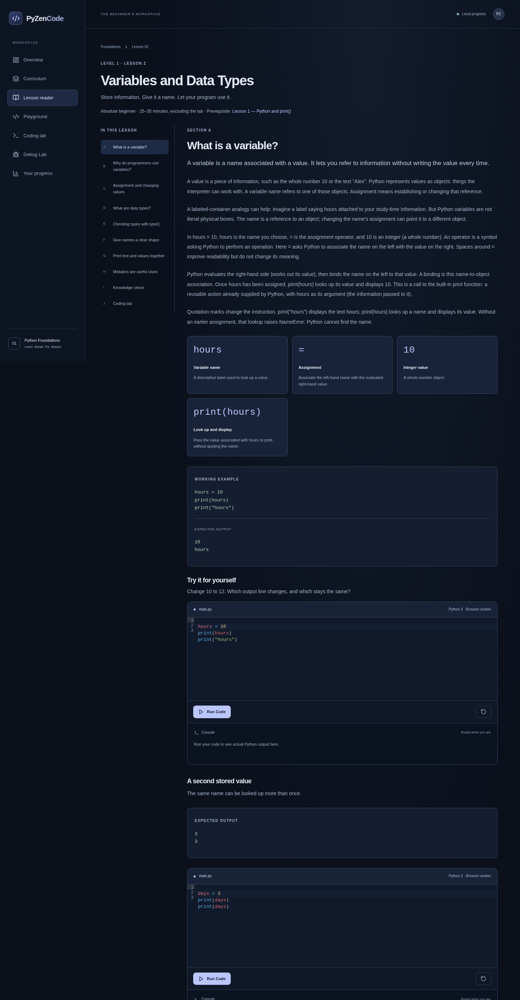
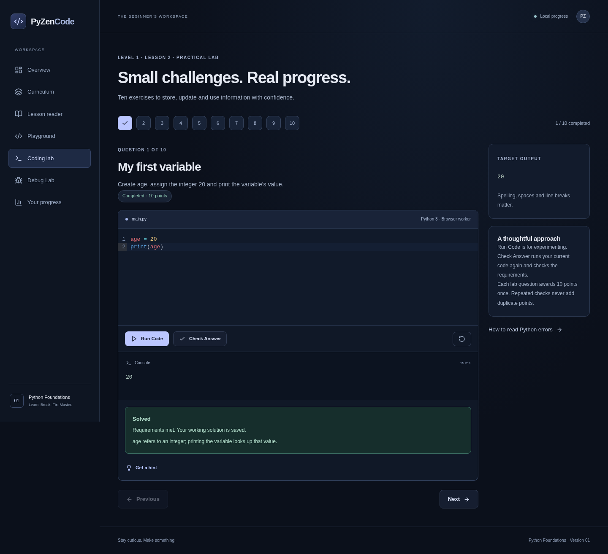
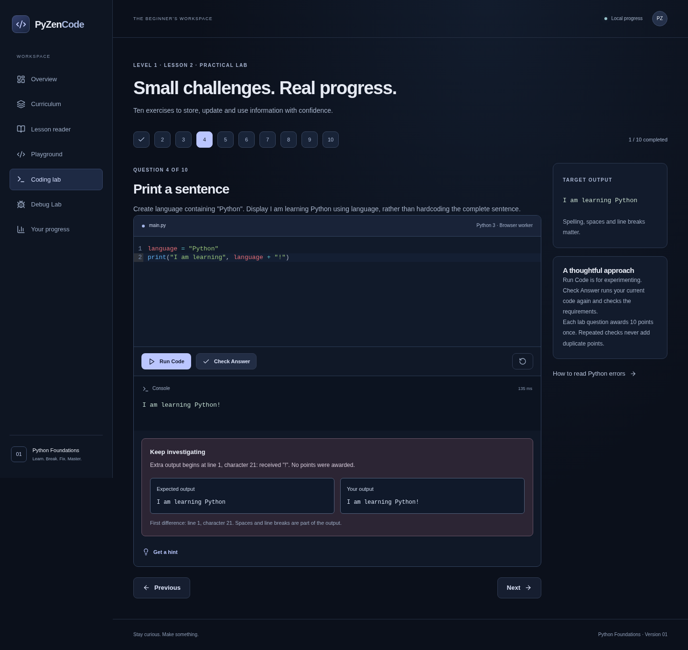

# Lesson 2 — Variables and Data Types

Implemented inside the existing PyZenCode application on `feat/lesson-2-variables`. Lesson 1, its routes/content/exercise IDs, saved code, progress key, Debug Lab, dashboard and worker timeout recovery are retained. No Yunomi files, dependencies, Vite configuration or tracked Vercel configuration were changed.

## Learning experience

Absolute Beginner · 25–35 minutes, excluding the practical lab · Prerequisite: Lesson 1.

Sections A–H explain variables as name-to-object references (with the limits of the container analogy), reuse/readability, assignment and right-hand evaluation, int/float/str and rounding limitations, nested type() calls, naming/keywords/snake_case, printing text with values, and seven real debugging examples. They include multiple runnable examples, exact output, visual code breakdowns, tables, common mistakes and short explained checks. Section I has five final knowledge questions; Section J opens exactly ten practical exercises matching the brief.

Lesson 2 appears in the curriculum immediately but remains locked until the existing Lesson 1 completion criteria are satisfied: eight sections marked read, five correct final quiz answers and ten checked lab passes. Direct reader/lab URLs use the same guard. Continue Learning selects the next incomplete section, final check or lab, then advances to Lesson 2 when Lesson 1 is complete.

Read, answer, draft and completion IDs are namespaced for the second lesson. The existing `pyzencode.progress.v1` key and version remain readable without destructive migration. Each lesson awards at most 100 points; the total is 200. Debug and quick-check activities add no lab points. Existing data-loading/storage-error/deletion behavior is retained.

## Meaningful grading

Check Answer runs the current program in real Pyodide. It verifies output plus required variable names, stored values and exact types. It records assignments to check score = 50 before the update to 80. The type exercise requires an actual call to the built-in type function on the stored value; an alias of type works.

The worker then reruns the program in fresh scopes with controlled assignment substitutions: a changed age must change the displayed age, changed day values must change the computed total, and a changed price type must change the type inspection. This rejects a program that creates unused variables and prints a fixed expected sentence. No model-answer source-string comparison is used. Ordinary, chained, unpacked, annotated, augmented and named-expression assignments, variable aliases and equivalent valid calculations are supported.

Both lessons share a reusable expected-versus-actual comparison that reports the first differing line and Unicode character. Capitalization, spaces/line breaks, missing output and extra output have distinct explanations. Runtime errors still show real tracebacks and friendly authored guidance; hints remain progressive rather than revealing complete solutions.

The helper is in `frontend/public/execution.py`, a static browser asset fetched by the disposable worker. All learner execution and observation happen in the browser. FastAPI only gains lesson metadata; it has no learner-code execution endpoint. Initialization/execution timeouts, output limits, worker termination and fresh-run recovery remain in place. The execution deadline covers the baseline plus changed-value checks in that request.

## Rendered previews

These are screenshots of the actual app in Chromium, with reduced motion. Only the prerequisite Lesson 1 completion state was seeded as an explicit developer test fixture to open Lesson 2; it is not evidence of a real student completing Lesson 1. The shown Lesson 2 lab pass and incorrect-output feedback came from actual Pyodide execution and grading, not simulated output. Fictional example values are from the requested lesson.

### Lesson introduction



### Real graded lab



### Shared output comparison



Additional previews: [data types and rounding](previews/lesson2-data-types.png), [type inspection](previews/lesson2-type-inspection.png), [curriculum](previews/lesson2-curriculum.png), [mobile first viewport](previews/lesson2-mobile-top.png), [full mobile lesson](previews/lesson2-mobile.png).

## Validation

- TypeScript and formatting checks passed.
- 50 frontend unit tests passed, including the existing suite and new content, variable grading, type-call evidence, assignment history, changed-value requirements, unlocking, namespaced persistence, points and precise output comparison checks.
- 26 Python/backend tests passed: original service tests, new lesson metadata and trusted local CPython tests exercising the exact browser execution helper with all ten solutions, substituted values, alternate assignment forms, type-function aliases, preserved error line numbers, fresh scopes and output limits. One upstream Starlette/AnyIO deprecation warning remains.
- The production build passed and includes `execution.py`, `python-worker.js` and the pinned interpreter assets. The editor stays in a separate lazy bundle.
- All 12 Chromium tests passed (seven preserved Lesson 1 tests and five Lesson 2 tests). The suite includes the preserved seven Lesson 1 tests plus actual prerequisite unlocking after a Lesson 1 pass, all ten new correct/incorrect/alternative programs, rejected hardcoded output and incorrect types, type-function inspection, 100 new points after reload with old points/drafts preserved, runnable examples/quick/final checks, all seven debugging corrections, and shared/mobile comparison feedback.
- Lesson 2 screens rendered without page errors; introduction, types, graded lab, comparison and the 390px first viewport were visually inspected. Browser checks cover phone/tablet viewport widths, not physical devices.

88 automated tests passed in total. The final production-browser run completed in approximately 4.9 minutes here.

The exact setup/check commands remain in the root [README](../README.md). Browser tests start a production preview themselves:

```sh
cd frontend
npm ci
npm run typecheck
npm test
npm run format:check
npm run build
npx playwright install chromium
npm run test:e2e
```

From repository root with the Python venv installed:

```sh
.venv/bin/python -m pytest -q
```

## Limits and deployment review

This observational grader is learning feedback, not a formal proof of arbitrary program correctness or a trusted certification system. Required variables are inspected at module scope. Advanced dynamic bindings through exec/globals mutation, function-local-only bindings and programs that intentionally tamper with the observer are outside the supported beginner patterns. Assignment histories retain the first 32 observed values per name; the lessons need only one or two. See [security boundaries](../SECURITY.md).

The Vercel URL returned HTTP 403 from this environment, so the deployed site/preview was not verified. Its existing deployment configuration is unchanged. Before merging, confirm that any generated preview serves the new same-origin static `execution.py` asset as text and executes Lesson 2 on the browsers you support. A preview on a different origin starts with separate local progress; existing main-site progress remains on its original origin and requires no schema reset after a same-origin deployment.

Safari/Firefox, physical mobile devices, screen readers and native keyboard/resource behavior remain unverified. No automatic merge or manual production deployment is performed.
