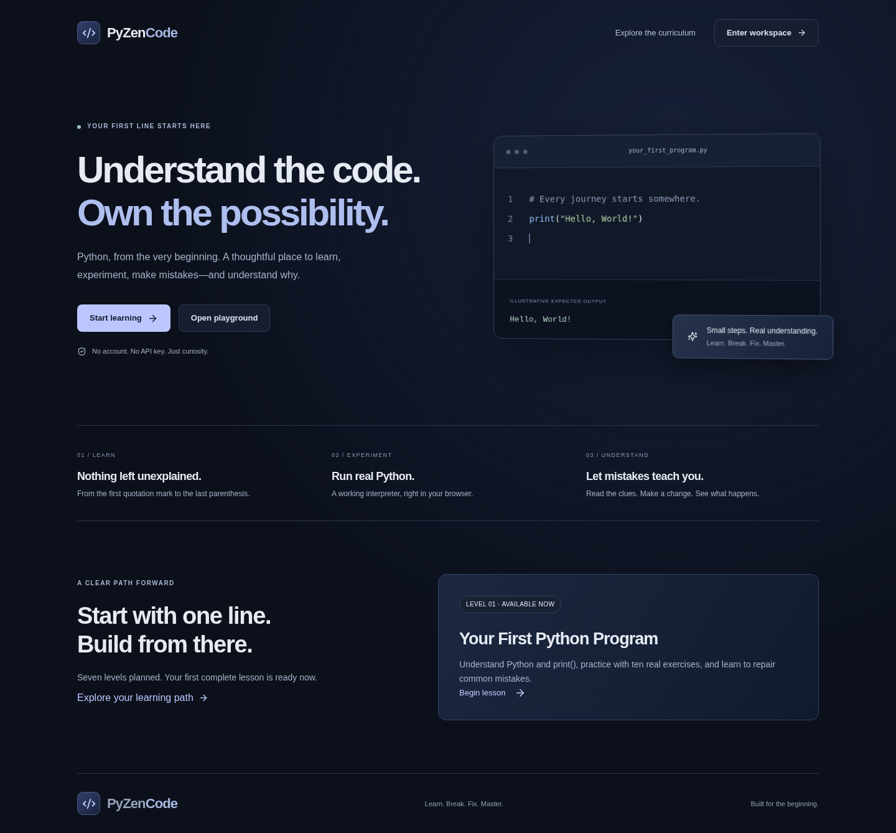
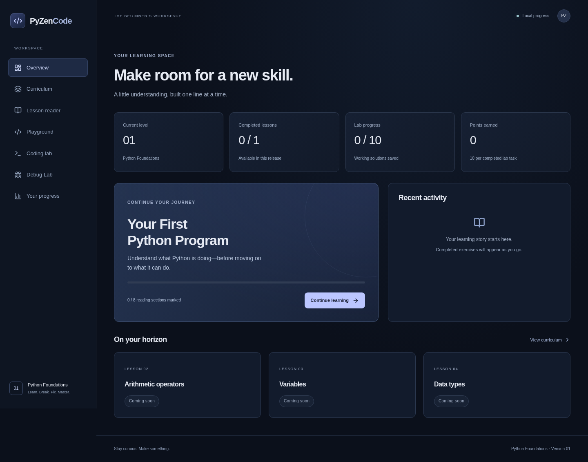
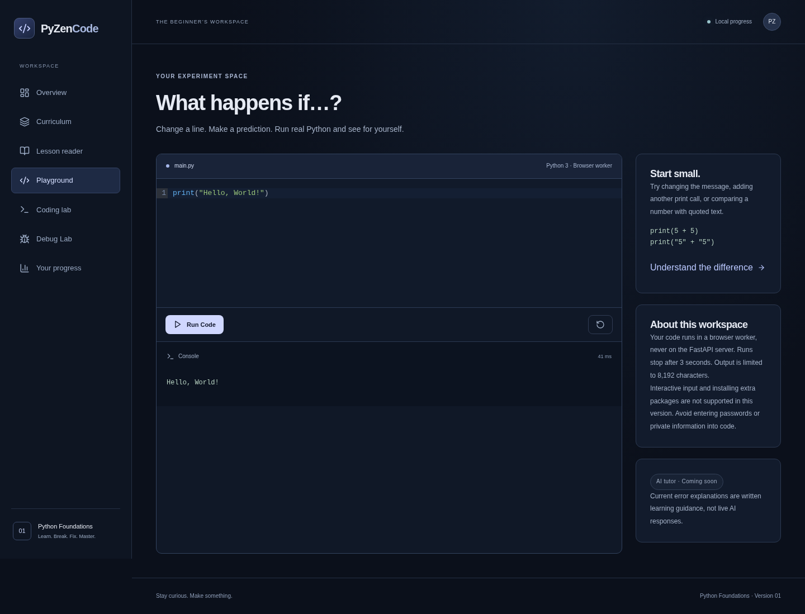

# First-release rendered review and validation

These are historical checks and screenshots for Lesson 1. See [Lesson 2 validation and previews](LESSON_2.md) for the current feature branch.

This is an implemented web application, not a mockup. The screenshots below were captured from the real running app in Chromium. The playground screenshot includes actual Pyodide output from clicking Run Code; other screenshots use a fresh browser profile with no invented student accomplishments.

## Checks performed

- **TypeScript:** `npm run typecheck` passed, including strict checks and unused imports/parameters.
- **Frontend unit tests:** 20 passed across content loading, runtime-based grading, incorrect submissions, integer types/call counts, progress serialization/idempotent points/deletion/quota failure, worker lifecycle/timeouts/cancellation/retry, and error explanations.
- **FastAPI tests:** 4 passed for health, shared curriculum, honest feature availability and absence of a server execution endpoint. One upstream Starlette/AnyIO deprecation warning remains; it did not cause a failure.
- **Production build:** passed; the lazy editor bundle is separate from the initial application bundle. Same-origin Pyodide assets are present in the export.
- **Formatting:** `npm run format:check` passed.
- **Real-browser E2E tests:** 7 passed against the production export, using system Chromium. They execute real Python, not mocked workers:
  1. Landing/lesson navigation, annotated syntax, incorrect/correct quiz explanations, and mobile navigation.
  2. All ten lab tasks, valid single-quote/concatenation/arithmetic alternatives, incorrect output, quoted integer and insufficient print-call rejection, no points for Run, no duplicate points, 100 points after reload, and persisted code drafts.
  3. Actual NameError, real traceback, progressive hint, correction, 8,192-character output cap, infinite-loop worker termination and a successful fresh run.
  4. Blocked interpreter asset initialization visibly fails; retry after restoring access executes Python.
  5. Damaged saved progress is preserved until explicit reset.
  6. The lesson’s multiline, empty-print, strings/numbers and comment examples match their expected output. Unquoted words, missing parentheses and an unterminated string produce their actual Python errors.
  7. All eight areas fit 320px, 390px and 768px viewports without horizontal overflow or browser page errors.
- **Service startup:** FastAPI health/feature endpoints responded over HTTP; the development Vite `/api` proxy successfully returned the health response.
- **Visual capture:** all eight desktop areas and a mobile lesson rendered with no page errors. Landing, lesson, mobile lesson and actual-output playground previews were visually inspected.

31 automated tests passed in total. The complete E2E suite passed in approximately 1.6 minutes here. Early test attempts interrupted by development asset/HMR changes were replaced by tests against a stable production export; no failed test was removed or weakened to report success. Real Python also corrected the teaching distinction that `print(Coding is fun)` raises NameError for Coding, while a missing closing parenthesis produces SyntaxError.

## Previews

### Landing

### Student dashboard

### Real Python playground

### More screens

- [Curriculum](previews/curriculum.png)
- [Lesson reader and annotated syntax](previews/lesson.png)
- [Ten-question lab](previews/lab.png)
- [Debug Lab](previews/debug.png)
- [Progress dashboard](previews/progress.png)
- [390px lesson reader](previews/mobile-lesson.png)

## Not verified or implemented

No Safari/Firefox or physical iPhone/Android device was used. Viewport responsiveness does not prove native browser keyboard/accessibility behavior, screen-reader support or real-device memory performance. Manual browser/device accessibility and cross-browser review remain appropriate.

Supabase authentication/cloud synchronization, AI tutoring, future lessons and public hosting are not implemented or deployed. Their availability is stated honestly in the app. Browser execution is not a hostile-code security sandbox; consult [SECURITY.md](../SECURITY.md).

Initial GitHub repository creation failed because the integration lacks `createRepository` permission. After the user created the public repository, the existing code was successfully pushed to `feat/first-working-version` and [PR #1](https://github.com/suzenops/pyzencode/pull/1) was opened into `main`, without rebuilding the app. It remains unmerged. The validation above comes from the original completed implementation; tests were not rerun merely to publish it. Yunomi was left untouched.
